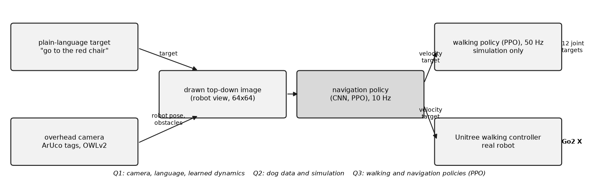
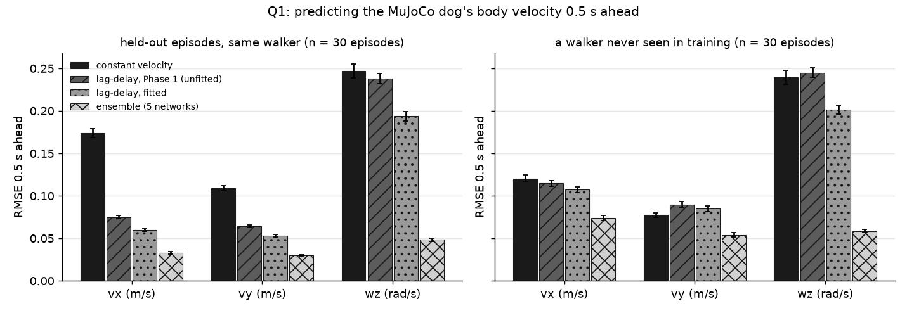
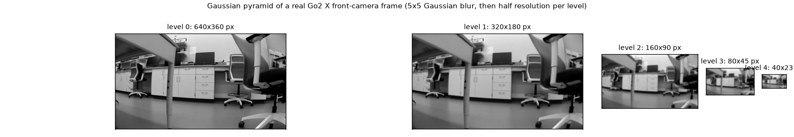
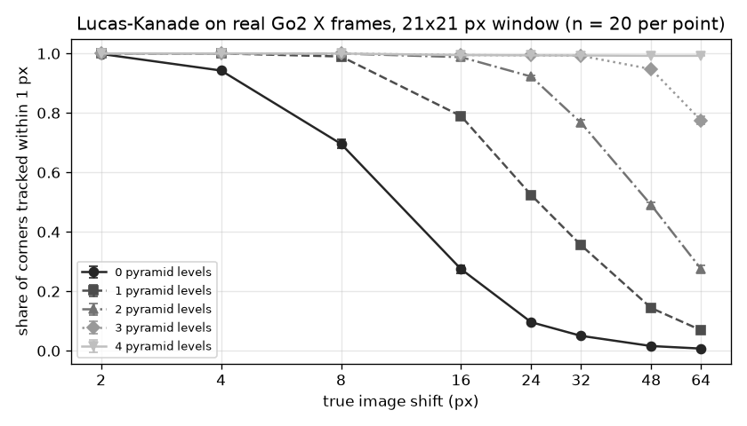
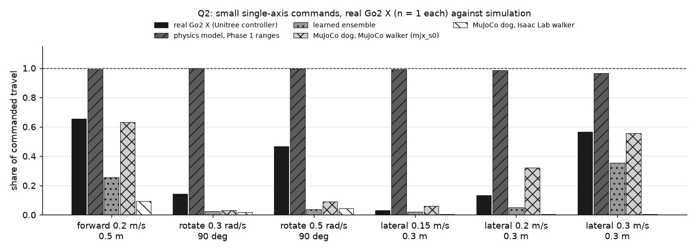
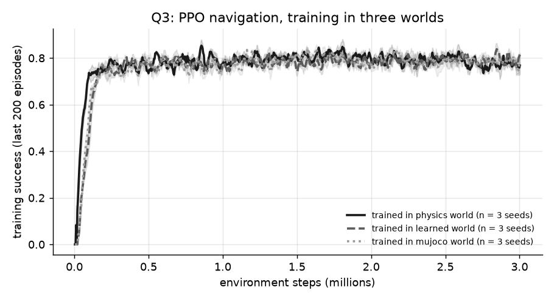
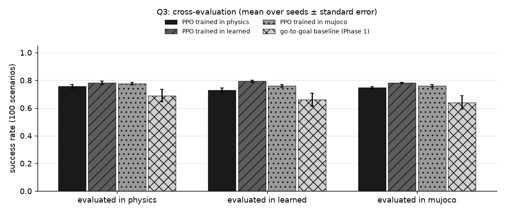

# ENGR 6010 Second Test: vision, language, learned dynamics and reinforcement learning on a Unitree Go2 X

Aidan Martin, ENGR 6010 (AI in Robotics), Middle Tennessee State University, fall 2026.

This report answers the three questions of the Second Test with one robot task: a Unitree Go2 X quadruped walks to an object named in plain language ("go to the red chair") in a 10 ft (3.048 m) square of an atrium.

- **Question 1 (vision, language, machine learning):**
  - an overhead camera with printed ArUco tags and the OWLv2 open-vocabulary detector turns a sentence into a target on the floor, on the real robot;
  - a supervised ensemble of 5 neural networks learns the dog's velocity response;
  - a Gaussian pyramid with pyramidal optical flow runs on the dog's own camera frames.
- **Question 2 (dog data and simulation):**
  - a documented dataset of real and simulated Go2 recordings;
  - a direct comparison of the real dog with five simulated dogs on the same command scripts;
  - the navigation policy's success on the real dog against the same policy in two simulators.
- **Question 3 (reinforcement learning, RL):**
  - a walking policy trained from scratch at the joint level;
  - a camera-image navigation policy that ran on the real dog (14 of 19 runs succeeded);
  - a proximal policy optimization (PPO) implementation written out in full, trained in three dynamics models and cross-evaluated.

All training ran on our own Dell workstation GPU and CPU at no cost, instead of the Colab Pro the course suggested.

**The walking policies never ran on the real robot.** On the real dog, the navigation policy sent velocity commands to Unitree's own walking controller.

## Contents

1. [Background and motivation](#1-background-and-motivation)
2. [Hardware and software](#2-hardware-and-software)
3. [Question 1: vision, language and machine learning](#3-question-1-vision-language-and-machine-learning)
4. [Question 2: dog data and simulation](#4-question-2-dog-data-and-simulation)
5. [Question 3: reinforcement learning](#5-question-3-reinforcement-learning)
6. [Reproduce](#6-reproduce)
7. [Data](#7-data)
8. [Repository layout](#8-repository-layout)
9. [References](#9-references)

## 1. Background and motivation

The course project (repository `aidanjmartin/ENGR6010_Go2X_SafeRL`, here as the `project/` submodule) aims at a Go2 X that walks to an object named in plain language, guarded by a safety filter built on a learned model of the dog's dynamics. Each piece answers a need:

| need | piece | question |
| :--- | :--- | :--- |
| know where the robot, the obstacles and the named object are | overhead camera, ArUco tags, homography to the floor, OWLv2 detections | Q1 (A) vision, (B) language |
| predict where the dog will be a fraction of a second after a command, so a safety filter can stop unsafe commands before they are sent | learned dynamics ensemble | Q1 (C) machine learning |
| data to fit and test those models, and a simulator that behaves like the dog | dataset, MuJoCo dog, simulation-against-real comparisons | Q2 |
| a controller that walks and one that steers from the camera image | walking policy and navigation policy, trained with PPO | Q3 |



The navigation policy reads a drawn top-down image made from the camera and sends a body velocity target (vx, vy, wz) at 10 Hz. In simulation a learned walking policy turns that target into 12 joint position targets at 50 Hz. On the real robot, Unitree's walking controller does it instead.

**Plan, not yet built:** the safety filter itself. The learned dynamics model in Question 1 is its first part.

**What is more mature than Exam 1:**

| topic | Exam 1 | Second Test |
| :--- | :--- | :--- |
| vision methods | color space, Gaussian pyramid, optical flow, GrabCut on synthetic images | ArUco calibration and tag pose, OWLv2 language targets on the real robot; pyramidal optical flow on the dog's real camera frames with known ground truth |
| supervised learning | five classifiers on synthetic patches | a probabilistic ensemble that predicts the dog's motion, tested against physics models and on a walker it never saw |
| dog data | 20 s stationary recording over WebRTC (Web Real-Time Communication), a data-collection plan | that recording analyzed; 2.4 h of simulated Go2 data with joint, contact and torque fields; real motion tests and 25 real navigation runs compared with simulation |
| simulation | `unitree_rl_gym` walking in Isaac Gym, 500 iterations, playback at 1.0 m/s | walking trained from scratch in Isaac Lab and in MuJoCo, tested under 13 conditions on Unitree's full Go2 model; navigation in an atrium model; the MuJoCo dog compared with the real dog |
| reinforcement learning | the `unitree_rl_gym` walking example | three RL systems, one run on the real dog, one with every PPO component written out here |

## 2. Hardware and software

| item | details |
| :--- | :--- |
| robot | Unitree Go2 X quadruped, Unitree's firmware and walking controller |
| links | Ethernet tether (Exam 1 and the Phase 1 motion tests, 2026-10-17); the robot's Wi-Fi hotspot (navigation runs, 2026-11-06); both over WebRTC with `unitree_webrtc_connect`, no phone app |
| camera (real runs) | Logitech Brio 100 webcam, 6.76 m above the floor on the second floor, over USB to the MacBook |
| laptop | MacBook (Apple M5, macOS): robot runs, camera pipeline, OWLv2 on the CPU |
| workstation | Dell, Intel Core Ultra 9 285K, NVIDIA RTX 4000 Ada (20 GB), Ubuntu 24.04.5: all training and evaluation, through a job runner for the project and directly for this test |
| simulators | Isaac Lab v2.3.2 on Isaac Sim 5.1.0; MuJoCo 3.16.0 and MuJoCo XLA (MJX) with Brax 0.14.2; Unitree's `go2.xml` (`unitree_mujoco` `1eb6642`) |
| learning libraries | RSL-RL 3.1.2 (project PPO), Brax PPO (MJX walking), PyTorch 2.7.0 (this test's PPO and ensemble), OpenCV 4.11.0 |
| code versions | this repository; `project/` submodule pinned to `phase2-rl-sim` commit `46db755`; project `main` at `3cc7e15` (Phase 1); Exam 1 at `90150da` |

## 3. Question 1: vision, language and machine learning

### 3.1 (A) vision and (B) language: "go to the red chair" on the real dog

**Method** (project `go2x/vision`, `go2x/grounding.py`, `docs/ROBOT_RUN.md`):

1. **Lens calibration:** a printed ChArUco board (a chessboard with ArUco markers) gives the webcam's focal length and distortion (OpenCV).
2. **Floor calibration:** four ArUco tags (`DICT_4X4_50`) lie on the corners of the square. Their known floor positions and their pixel positions give the camera pose and the image-to-floor homography (a 3 by 3 projective map).
3. **Robot pose:** a tag on the robot's back, at a measured height (0.41 m), gives its position and heading every frame. The tag's center is projected through the camera model at that height, not the floor's. Odometry fills gaps of up to 2 s.
4. **Obstacles and targets:** OWLv2 (Open-World Localization, version 2), an open-vocabulary detector, is asked for "a chair", "a red chair" and so on, about once a second. The bottom center of each box is mapped to the floor with the homography. Optional tags on chairs (ids 20 to 24) fix a chair's position and give its color ("red" is the tag's, not the chair's look).
5. **Language to target:** the phrase "go to the {color} chair" or "go to the table" selects one object. Its footprint becomes the target channel of the drawn top-down image the navigation policy reads (Question 3).

**Results, rendered scenes** (project job 070, 60 scenes rendered in MuJoCo, 132 prompts; `results/phase2/grounding/grounding_eval.json`). A prompt is correct when the floor point from the best box lies within 0.3 m of the target's footprint.

| prompt | correct |
| :--- | ---: |
| all prompts | 0.614 ± 0.043 (n = 132) |
| "go to the {color} chair" | 0.851 ± 0.044 (n = 67) |
| "go to the table" | 0.960 ± 0.039 (n = 25) |
| "go to the chair" (no color) | 0.000 ± 0.000 (n = 15) |
| "go to the person" | 0.000 ± 0.000 (n = 25) |

Two failures stand out:
- **People:** the scenes model a person as an orange cylinder, so OWLv2 has nothing person-shaped to find.
- **"go to the chair":** without a color it failed every time; the reason is not yet checked.

**Results, real robot** (2026-11-06; project `LOG.md` step 13 and `results/robot/nav_camera_runs_webrtc.md`):
- **Lens:** calibration error 0.59 px on 33 board views; 0.59 px on held-out views.
- **Floor:** the corner-tag fit leaves 7.7 px of error, because the printed tags were not on a true square (sides 2.98 and 3.11 m against 3.048 m; tag 3 about 5.5 cm off its corner).
- **Robot pose:** the camera gave it on 507 of 521 policy steps.
- **Target by tag color:** "red chair" picked tag 20's chair in 180 of 180 checks.
- **Overall:** 14 of 19 runs with policy steps reached the named target (Question 3).

### 3.2 (C) supervised learning: a learned model of the dog's motion

**Task:** predict the dog's body velocity (vx, vy, wz) 0.1 s and 0.5 s ahead, given its last 4 velocities and velocity commands and the commands over the horizon. This is the prediction a safety filter needs.

**Data:** the simulated split of the Question 2 dataset, the MuJoCo dog walked by the MuJoCo-trained walking policy. It holds 119,200 training pairs from 200 episodes, plus 30 validation, 30 test and 30 "shift" episodes. The shift episodes use a different walking policy (the Isaac Lab walker), never seen in training. The raw logs of the real motion tests are on the MacBook, so the model was trained on simulated data only.

**Model** (`q1_vision_ml/train_ensemble.py`, `exam2/models.py`): an ensemble of 5 probabilistic networks, following PETS (probabilistic ensembles with trajectory sampling) [Chua et al., 2018]:
- **Network:** 3 hidden layers of 200 SiLU units each, predicting a Gaussian mean and variance of the next velocity change.
- **Training:** a bootstrap resample of the data per member; Gaussian negative log likelihood with learned variance bounds; Adam, 40 epochs.
- **Rollout:** autoregressive, with the members' mean.

**Compared with:**
- constant velocity;
- the Phase 1 physics model (per-axis first-order lag with dead time) at its unfitted mean settings (time constant 0.25 s, delay 0.075 s);
- the same lag-delay model fitted to the training data by grid search (time constants 0.26, 0.24, 0.28 s; delay 0 s).

**Results** (`q1_vision_ml/results/ensemble_eval.md`): root mean square error (RMSE) per episode at the horizon, then mean ± standard error over 30 episodes.

| 0.5 s ahead | vx (m/s), test | wz (rad/s), test | vx (m/s), shift | wz (rad/s), shift |
| :--- | ---: | ---: | ---: | ---: |
| constant velocity | 0.174 ± 0.005 | 0.247 ± 0.008 | 0.120 ± 0.004 | 0.240 ± 0.008 |
| lag-delay, Phase 1 (unfitted) | 0.075 ± 0.002 | 0.238 ± 0.006 | 0.115 ± 0.003 | 0.245 ± 0.006 |
| lag-delay, fitted | 0.060 ± 0.002 | 0.194 ± 0.006 | 0.107 ± 0.003 | 0.202 ± 0.005 |
| ensemble (5 networks) | **0.033 ± 0.001** | **0.048 ± 0.002** | **0.074 ± 0.003** | **0.059 ± 0.002** |



- **Accuracy:** the ensemble halves the fitted physics model's forward error and cuts its turning error by three quarters, 0.5 s ahead.
- **New walker:** on the walker it never saw, its forward error doubles (0.033 to 0.074 m/s) but stays the lowest of the four models.
- **Uncertainty:** its one-step 95 % (2-sigma) intervals hold 96.5 to 96.9 % of the true values on the test split. On the shift split they hold 88.3 to 94.0 %: it is overconfident on the new walker, as an ensemble trained on one walker can be.
- **Small commands:** Question 2 shows a limit. Over long open-loop runs of small commands, the ensemble moves the dog less than the MuJoCo dog it learned from (0.26 against 0.63 of a 0.5 m forward command).

### 3.3 (A) vision: Gaussian pyramid and pyramidal optical flow on the dog's camera

**Method** (`q1_vision_ml/flow_pyramid.py`):
- **Frames:** the four real front-camera frames recorded over WebRTC in Exam 1 (640 by 360, dog standing still).
- **Pyramid:** each level blurs with a 5 by 5 Gaussian and halves the resolution [Burt and Adelson, 1983].
- **Tracking:** Lucas-Kanade optical flow [Lucas and Kanade, 1981] in its pyramidal form [Bouguet, 2001], on Shi-Tomasi corners [Shi and Tomasi, 1994], with a 21 by 21 pixel window.
- **Ground truth:** each real frame is shifted by a known amount (2 to 64 px, random direction) with sensor noise added. Tracking runs with 0 to 4 pyramid levels.



**Results** (`q1_vision_ml/results/flow_pyramid.md`): share of corners tracked within 1 px of the truth, mean ± standard error over 20 trials per shift.

| shift (px) | 0 levels | 1 level | 2 levels | 3 levels | 4 levels |
| ---: | ---: | ---: | ---: | ---: | ---: |
| 8 | 0.696 ± 0.014 | 0.990 ± 0.002 | 1.000 ± 0.000 | 1.000 ± 0.000 | 1.000 ± 0.000 |
| 16 | 0.275 ± 0.013 | 0.789 ± 0.008 | 0.988 ± 0.002 | 0.995 ± 0.001 | 0.995 ± 0.001 |
| 32 | 0.050 ± 0.005 | 0.355 ± 0.012 | 0.767 ± 0.012 | 0.992 ± 0.001 | 0.993 ± 0.001 |
| 64 | 0.007 ± 0.001 | 0.069 ± 0.006 | 0.275 ± 0.011 | 0.775 ± 0.013 | 0.992 ± 0.001 |



- **Why the pyramid matters:** single-level Lucas-Kanade loses track beyond about 8 px of motion (0.70 of corners within 1 px at 8 px, 0.28 at 16 px). Each pyramid level doubles the motion it can follow, and 4 levels track 99 % of corners at 64 px. When the dog turns, the scene sweeps across the image by tens of pixels per frame.
- **Real frames:** between consecutive frames of the standing dog, the median flow is 0.07 to 0.09 px (300 corners per pair). The camera is effectively still.

**Limitations of Question 1:**
- 19 real runs is a small sample.
- People are cylinders in the rendered evaluation.
- The corner tags are about 5.5 cm off a true square.
- OWLv2's floor points lie 0.1 to 0.35 m nearer the camera than the truth in simulation.
- The ensemble learned from simulated data only.
- The optical-flow test uses synthetic shifts of real frames, because no recording of the dog's camera while walking exists.

## 4. Question 2: dog data and simulation

### 4.1 Dataset

[`q2_data/dataset/DATASET.md`](q2_data/dataset/DATASET.md) documents every file and field.

| part | content | size |
| :--- | :--- | :--- |
| real, standing (`real_exam1/`) | 400 sport-state messages (body height, velocity estimate) at 20 Hz, 20 low-state messages (IMU, foot force sensors, battery) at 1 Hz, 5 camera frames | 0.2 MB |
| simulated (`sim/`) | 290 episodes of 30 s (2.4 h) of the MuJoCo Go2 under random velocity commands, with foot friction and payload drawn per episode. Fields follow [`unitree_go2_create_dataset`](https://github.com/ShijieZhao36/unitree_go2_create_dataset): `foot_force`, `motor_q`, `motor_dq`, `motor_ddq`, `motor_tau_est`, plus command, body velocity, pose and IMU | 42 MB |
| real runs (`results/robot/`) | 4 L-path trials (2026-10-17) and 25 navigation runs (2026-11-06), per run | tables |

The raw logs of the real runs (`state.jsonl`, `commands.jsonl` and others) are on the MacBook and not in this repository ([Data](#7-data)).

### 4.2 Sensor statistics of the standing dog

`q2_data/sensor_stats.py`, real against 215 settled standing stretches of the MuJoCo dog (`q2_data/results/sensor_stats.md`):

| quantity | real mean | real sd | simulated mean | simulated sd |
| :--- | ---: | ---: | ---: | ---: |
| body height (m) | 0.3207 | 2.2e-06 | 0.3177 | 0.0019 |
| velocity vx (m/s) | +0.0004 | 0.0073 | -0.0003 | 0.0028 |
| velocity vy (m/s) | -0.0010 | 0.0074 | +0.0000 | 0.0011 |
| roll (rad) | -0.0310 | 0.0002 | +0.0048 | 0.0044 |
| pitch (rad) | -0.0136 | 0.00032 | -0.0150 | 0.008 |

- **Body height:** the real dog reports the same height to a few micrometers. The value is the controller's estimate, not a measurement.
- **Velocity estimate:** the real estimate is noisier (sd 7 mm/s) than the simulated dog's true sway (1 to 3 mm/s) and has a vertical bias of -0.029 m/s while standing.
- **Posture:** Unitree's standing controller holds roll and pitch about 20 times steadier than the learned walker does in simulation.
- **Timing:** sport-state messages arrived every 50.0 ms (95th percentile 51.7 ms).

### 4.3 The real dog against five simulated dogs

The Phase 1 motion scripts were replayed command for command in five worlds (`q2_data/small_commands.py`, `q2_data/l_path_replay.py`):
- the Phase 1 physics model (lag-delay, parameters drawn from its unfitted ranges);
- the same model fitted to the MuJoCo dog;
- the learned ensemble;
- the MuJoCo dog with each of the two trained walking policies.

The scripts use the same 20 Hz commands, rate limits and stop rules as on the robot. Real values are the robot's odometry and IMU from the project `LOG.md` (main) and `results/robot/l_path_trials_webrtc.md`.

**Small single-axis commands** (share of the commanded travel delivered; real n = 1 per test; `q2_data/results/small_commands.md`):

| world | forward 0.2 m/s | rotate 0.3 rad/s | rotate 0.5 rad/s | lateral 0.15 m/s | lateral 0.2 m/s | lateral 0.3 m/s |
| :--- | ---: | ---: | ---: | ---: | ---: | ---: |
| real Go2 X (Unitree controller) | 0.65 | 0.14 | 0.47 | 0.03 | 0.13 | 0.57 |
| physics model, Phase 1 ranges (n = 10) | 0.99 | 1.00 | 1.00 | 0.99 | 0.98 | 0.97 |
| learned ensemble (n = 10) | 0.26 | 0.02 | 0.04 | 0.02 | 0.05 | 0.36 |
| MuJoCo dog, MuJoCo walker (n = 5) | 0.63 | 0.03 | 0.09 | 0.06 | 0.32 | 0.56 |
| MuJoCo dog, Isaac Lab walker (n = 5) | 0.09 | 0.02 | 0.05 | 0.00 | 0.00 | 0.01 |



**L-path test** (forward 0.5 m, turn left 90 degrees, forward 0.5 m, closed loop on odometry; mean ± sd; `q2_data/results/l_path_replay.md`):

| world | n | leg 1 (m) | turn (deg) | end forward (m) | end left (m) | segment timeouts |
| :--- | ---: | ---: | ---: | ---: | ---: | ---: |
| real Go2 X | 4 | 0.369 ± 0.063 | 82.3 ± 2.5 | 0.414 ± 0.089 | 0.414 ± 0.193 | 3 |
| physics model, Phase 1 ranges | 10 | 0.525 ± 0.012 | 92.7 ± 1.9 | 0.500 ± 0.029 | 0.524 ± 0.012 | 0 |
| learned ensemble | 10 | 0.454 ± 0.030 | 3.7 ± 7.9 | 0.911 ± 0.071 | -0.058 ± 0.096 | 13 |
| MuJoCo dog, MuJoCo walker | 10 | 0.446 ± 0.000 | 2.8 ± 0.0 | 0.897 ± 0.001 | -0.070 ± 0.001 | 10 |
| MuJoCo dog, Isaac Lab walker | 10 | 0.046 ± 0.000 | 7.8 ± 0.0 | 0.044 ± 0.000 | -0.017 ± 0.000 | 30 |

What the data shows:
- **Small commands:** the real dog under-delivers small commands, as a minimum speed in its gait controller would cause. The Phase 1 physics model has no such effect and delivers everything.
- **Forward and sideways:** the MuJoCo dog with the MuJoCo-trained walker matches the real dog closely (0.63 against 0.65 forward at 0.2 m/s; 0.56 against 0.57 sideways at 0.3 m/s).
- **Turning in place:** both learned walkers barely turn when told to turn without moving (2 to 9 % of the angle). The real dog turns 14 to 47 %, and 82 degrees of 90 in the closed-loop L-path. The learned walkers' training rarely asks for a pure turn (each axis is drawn independently), which may explain it; this is not checked.
- **Isaac walker:** it ignores commands of 0.2 m/s or less, so it fails the L-path.
- **Learned ensemble:** it reproduces the MuJoCo dog it learned from in the L-path (0.91 against 0.90 m forward). For long runs of small commands it moves too little.
- **No simulation is right on every axis.** The fitted and learned models are only as good as the dog that produced their data; real-robot data is the next step.

### 4.4 The same navigation policy in simulation and on the real dog

`q2_data/nav_sim_vs_real.py` (`q2_data/results/nav_sim_vs_real.md`). The policy is Phase 2 navigation attempt 4 (Question 3). Start distance is from the robot's front to the target's footprint. Rates are ± binomial standard error.

| world | all | start < 1.9 m | start ≥ 1.9 m |
| :--- | ---: | ---: | ---: |
| real Go2 X, Unitree controller (2026-11-06) | 0.737 ± 0.101 (14/19) | 0.889 ± 0.105 (8/9) | 0.600 ± 0.155 (6/10) |
| Isaac Lab, learned walker (200 scenarios) | 0.780 ± 0.029 (156/200) | 0.811 ± 0.030 (137/169) | 0.613 ± 0.087 (19/31) |
| MuJoCo, MuJoCo walker | 0.810 ± 0.028 (162/200) | 0.834 ± 0.029 (141/169) | 0.677 ± 0.084 (21/31) |
| MuJoCo, Isaac Lab walker | 0.835 ± 0.026 (167/200) | 0.858 ± 0.027 (145/169) | 0.710 ± 0.082 (22/31) |

- **Agreement:** the real success rate lies within one real standard error of every simulation.
- **Distance:** in every world, starts of 1.9 m or more succeed less often.
- **Sample size:** 19 real runs cannot separate the worlds.

### 4.5 Digital twin and MuJoCo check

- **Digital twin:** the project's `scripts/robot/render_twin.py` rebuilds a run in MuJoCo from its logs alone. `results/phase2/mujoco_videos/twin_scenario023.mp4` is a simulated run rebuilt this way. Rendering twins of the real 2026-11-06 runs needs their raw logs, which are on the MacBook (not run here).
- **MuJoCo check of the Isaac Lab walker** (project job 080, `results/phase2/mujoco_check/mujoco_check.md`): on the same 100 episodes, its tracking error in MuJoCo is about twice that in Isaac Lab:
  - vx 0.125 against 0.060 m/s;
  - wz 0.194 against 0.101 rad/s;
  - no falls.

  Unitree's MuJoCo model adds joint damping, friction loss and armature that the Isaac model lacks. Whether these explain the gap is not yet checked.

**Limitations of Question 2:**
- The real motion data are single runs or 4 trials, measured by the robot's own odometry. Only the 2026-11-06 runs have camera ground truth, and their raw logs are not here.
- The camera-against-odometry drift analysis and the path-error replay of the 2026-11-06 runs were not run, for that reason.
- The real dog runs Unitree's controller, while the simulated dogs run our learned walkers.

## 5. Question 3: reinforcement learning

Three RL systems: two from the project, one written for this test. `unitree_rl_gym` (the course reference) describes the workflow Train, Play, Sim2Sim (MuJoCo), Sim2Real on Isaac Gym with `legged_gym` and `rsl_rl` (its README, `276801e`); Exam 1 ran its Go2 example. The walking policy here follows the same workflow on Isaac Lab through `unitree_rl_lab` (`4960b84`), Unitree's Isaac Lab counterpart, and keeps the MuJoCo Sim2Sim step. It also adds a second trainer in MuJoCo.

### 5.1 Walking from scratch (joint level, simulation only)

| component | setting (project `config/walk.yaml`, `config/walk_mjx.yaml`) |
| :--- | :--- |
| state (45 values) | base angular velocity x 0.2, projected gravity, velocity target, joint angles minus the default pose, joint velocities x 0.05, previous action |
| action | 12 joint position targets: default pose + 0.25 x action (rad) |
| low-level control | PD (proportional-derivative) torque at 200 Hz, kp 25 N m/rad, kd 0.5 N m s/rad, clipped to the motor limits; policy at 50 Hz |
| reward (16 terms, `unitree_rl_lab`) | track linear velocity xy (+1.5), track yaw rate (+0.75), vertical velocity (-2.0), roll and pitch rate (-0.05), joint velocity (-0.001), joint acceleration (-2.5e-7), torque (-2e-4), action rate (-0.1), joint limits (-10), energy (-2e-5), flat orientation (-2.5), joint deviation (-0.7), feet air time (+0.1), air-time variance (-1.0), feet slide (-0.1), undesired contacts (-1.0) |
| episode end | tilt above 0.8 rad, base contact, 20 s |
| commands | vx -0.5 to 1.0 m/s, vy ±0.5 m/s, wz ±1.0 rad/s, 10 % standing |
| randomization | friction 0.3 to 1.2, base mass -1 to +3 kg, motor strength and PD gains x 0.8 to 1.2, 20 to 40 ms action delay, pushes up to 0.5 m/s every 5 to 10 s, sensor noise |
| PPO, Isaac Lab | RSL-RL 3.1.2, `unitree_rl_lab` settings: 4096 environments, 24 steps each, actor and critic 512-256-128 ELU, 5 epochs, 4 minibatches, learning rate 1e-3 (adaptive, KL 0.01), clip 0.2, entropy 0.01, gamma 0.99, lambda 0.95 |
| PPO, MuJoCo MJX | Brax PPO with MuJoCo Playground's Go1 settings: 8192 environments, unroll 20, 32 minibatches, discount 0.97, learning rate 3e-4, entropy 0.01, 512-256-128 networks, critic with privileged state |

**Results** (`results/phase2/`):
- **Isaac Lab training:** 3000 iterations from random weights, 4096 environments, 53 min on the RTX 4000 Ada; 0.996 of the last 50 iterations' episodes reached 20 s (`walk_train/training_curve.png`).
- **Isaac Lab evaluation** (100 episodes, `walk_eval/walk_eval.md`): tracking error vx 0.060 ± 0.009 m/s, wz 0.101 ± 0.006 rad/s; 2 falls in 32.7 robot-minutes. Video: `walk_eval/walk_20s.mp4`.
- **MuJoCo MJX:** 6 runs of 200M steps, 27 to 28 min each: 3 seeds plus 3 ablations (`mujoco_walk/training_curves.png`, project `docs/MUJOCO_TRAINING.md`).
- **Robustness** on Unitree's full `go2.xml`, 13 conditions by 100 episodes (`mujoco_walk_eval/eval_walk.md`). Falls in 1300 episodes:

  | walker | falls / 1300 |
  | :--- | ---: |
  | Isaac Lab walker | 114 |
  | MJX walker, 3 seeds | 79, 66, 63 |
  | MJX, no randomization | 217 |
  | MJX, critic without privileged state | 70 |
  | MJX, pushes up to 1.0 m/s | 13 |

  Forward tracking on flat ground: 0.060 ± 0.001 m/s (MJX seed 0) against 0.119 ± 0.003 (Isaac walker). These tests run in MuJoCo, where the MJX walkers trained, so part of the gap is the Isaac walker's move between simulators. Video: `mujoco_videos/walk_demo_mjx_s0.mp4`.

### 5.2 Atrium navigation from a drawn camera image (ran on the real dog)

| component | setting (project `config/nav.yaml`, `config/topdown.yaml`, `go2x/isaac/nav_env_cfg.py`) |
| :--- | :--- |
| environment | Isaac Lab, 1024 Go2 robots, each walked by the frozen walking policy; 10 ft square with chairs, a table and walking people (cylinders) |
| state | drawn top-down image, 4 channels (static obstacles, people, robot footprint, target), current and previous frame (8 x 64 x 64), plus the previous action |
| action | velocity target, vx 0 to 0.8 m/s, vy ±0.3 m/s, wz ±1.0 rad/s, at 10 Hz |
| reward | progress toward the target +4.0 per m, success +20, collision -10, fall -10, leaving the square -10, near a person -0.2 per step, time -0.02 per step, action change -0.05 |
| episode end | success (front within 0.5 m of the target footprint at under 0.1 m/s), collision, fall, leaving the square, 20 s |
| policy and value networks | convolutional encoder (16, 32, 32 channels, stride 2) into 128 features, then a 128-64 multilayer perceptron; the critic also sees the target vector and velocities |
| PPO | RSL-RL 3.1.2, 32 steps per environment, learning rate 3e-4, entropy 0.01, 1500 iterations |

**The robot-view finding** (project `LOG.md` step 10): attempts 1 and 3 drew the image in the world frame. They learned no steering: probed with the target at every bearing, attempt 3 turned left in place and attempt 1 drove a fixed arc. A network trained by supervised learning to predict the target's bearing from the world view still erred by 23 degrees (median) after 2750 steps. From the robot view, with the robot at the center facing up, it erred by 1.6 degrees after 250 steps. Attempt 4 uses the robot view, and the policy then steers.

**Results** (200 shared scenarios in Isaac Lab, `results/phase2/nav_eval_attempt4/` and `nav_baselines/`):

| controller | success | collision | time to goal (s) |
| :--- | ---: | ---: | ---: |
| straight to target | 0.580 ± 0.035 | 0.410 ± 0.035 | 3.18 ± 0.07 |
| A* path planner with pure pursuit | 0.695 ± 0.033 | 0.290 ± 0.032 | 3.96 ± 0.09 |
| attempt 1 (world view) | 0.125 ± 0.023 | 0.240 ± 0.030 | 5.14 ± 0.44 |
| attempt 4 (robot view) | **0.780 ± 0.029** | **0.200 ± 0.028** | 3.28 ± 0.13 |

- **Trained in MuJoCo:** the same task over the MJX walker, with entropy 0.003, reached 0.860 ± 0.025 (`results/phase2/mujoco_nav_eval/mjx_walker/nav_eval_mujoco.md`).
- **Real dog:** 14 of 19 runs with policy steps succeeded (0.737 ± 0.101). The policy ran on the MacBook, sent velocity commands over Wi-Fi to Unitree's walking controller, and was guided by the overhead camera of Question 1. There were 4 virtual-bumper stops and 1 camera loss (`results/robot/nav_camera_runs_webrtc.md`).
- **Videos:** `results/phase2/nav_videos/nav_policy_success_scenario000.mp4`, `mujoco_videos/nav_scenario023.mp4`, `camera_sim/camera_scenario014_green_chair.mp4`.

### 5.3 PPO written out in full: navigation trained in three dynamics models

**Question:** does a policy trained inside a learned model of the dog do as well as one trained inside the hand-built physics model, when both run on a more realistic dog?

**Task:** the Phase 1 navigation task (project `go2x/sim/nav_env.py`, unchanged). The dog starts in a random room of 4 to 8 m with 2 to 6 obstacles and must reach a goal at least 2 m away.

| component | setting (`q3_rl/ppo.py`, project `config/sim.yaml`) |
| :--- | :--- |
| state (41 values) | goal distance, cosine and sine of the goal bearing, body velocity, previous action, 32 LiDAR (light detection and ranging) ranges, all scaled to about [-1, 1] |
| action | Gaussian policy over [-1, 1]^3, scaled to vx ±0.5 m/s, vy ±0.3 m/s, wz ±0.8 rad/s, at 20 Hz |
| reward | +2.0 per m of progress, +10 success, -10 collision, -0.005 per step |
| episode end | within 0.3 m of the goal (success), collision, 40 s |
| policy network | 2 x 256 tanh multilayer perceptron, learned log standard deviation, orthogonal initialization |
| value network | separate 2 x 256 tanh multilayer perceptron |
| advantages | generalized advantage estimation (GAE) [Schulman et al., 2016], gamma 0.99, lambda 0.95, bootstrapped from the value of the final state on timeouts |
| PPO update | clipped surrogate (0.2), value loss weight 0.5, no entropy bonus, Adam 3e-4, 10 epochs, minibatches of 256, gradient norm clip 0.5; settings of the Phase 1 Stable-Baselines3 run |
| rollouts | 16 environments in parallel processes, 256 steps each per update, 3M steps per run |

**Three training worlds**, which differ only in the dynamics model (`exam2/dyn.py`):
- **physics:** the Phase 1 lag-delay model, its parameters drawn per episode from the unfitted ranges;
- **learned:** the Question 1 ensemble, one member per episode with sampled noise;
- **MuJoCo:** the MuJoCo dog, Unitree's `go2.xml` walked by the MJX walking policy. It is the closest model of the real dog available offline (Question 2).

Each world trained 3 seeds. Each policy was then evaluated, with its mean action, in all three worlds on the same 100 seeded scenarios (seeds 10000 to 10099, as in the Phase 1 evaluation). The Phase 1 go-to-goal controller, which ignores obstacles, was evaluated on the same scenarios as a baseline.

**Training:** 3M steps took 664 to 670 s in the physics and learned worlds and 910 to 922 s in the MuJoCo world, three runs at a time on the Dell's CPU (`q3_rl/runs/*/run.json`). Every run reached 0.74 to 0.81 training success by the end.



**Cross-evaluation** (`q3_rl/results/cross_eval.md`). Success rate, mean over 3 seeds ± standard error over seeds (100 scenarios per seed). Baseline: binomial standard error over 100 scenarios.

| controller | evaluated in physics | evaluated in learned | evaluated in MuJoCo |
| :--- | ---: | ---: | ---: |
| PPO trained in physics | 0.757 ± 0.015 | 0.730 ± 0.015 | 0.747 ± 0.009 |
| PPO trained in learned | 0.783 ± 0.012 | 0.793 ± 0.009 | 0.783 ± 0.003 |
| PPO trained in MuJoCo | 0.777 ± 0.009 | 0.760 ± 0.010 | 0.760 ± 0.010 |
| go-to-goal baseline (Phase 1) | 0.690 ± 0.046 | 0.660 ± 0.047 | 0.640 ± 0.048 |



Paired by scenario (success averaged over the 3 seeds, then the mean difference ± standard error over 100 scenarios; `q3_rl/results/paired_differences.json`):

| comparison | in physics | in learned | in MuJoCo |
| :--- | ---: | ---: | ---: |
| trained in learned - trained in physics | +0.027 ± 0.022 | +0.063 ± 0.024 | +0.037 ± 0.023 |
| trained in MuJoCo - trained in physics | +0.020 ± 0.022 | +0.030 ± 0.022 | +0.013 ± 0.025 |
| trained in learned - trained in MuJoCo | +0.007 ± 0.020 | +0.033 ± 0.020 | +0.023 ± 0.021 |

What the data shows:
- **The PPO implementation works.** Trained in the physics world, it reaches 0.757 ± 0.015 there. The Phase 1 Stable-Baselines3 policy reached 0.79 on the same 100 scenarios (one seed, project `main` `results/eval.md`). Every PPO policy beats the go-to-goal baseline in every world.
- **Which world to train in:**
  - The policy trained in the learned model is the best of the three in every evaluation world, including the MuJoCo dog (0.783 ± 0.003).
  - Paired by scenario, though, its lead over the physics-trained policy in the MuJoCo dog is +0.037 ± 0.023, under two standard errors. Only the learned world's advantage at home (+0.063 ± 0.024) clears two standard errors.
  - With 3 seeds and 100 scenarios, the three training worlds give policies that are about equal on this task.
- **Why the models matter little here:** the navigation policies command up to 0.5 m/s forward with turning, mostly outside the small-command range where Question 2 found the models disagree most.
- **Cost:** the learned model ran 1.5 times faster than the MuJoCo dog (5,856 against 3,978 steps per second in the speed test), with a policy as good.
- **Falls and timeouts:** no policy fell in the MuJoCo dog, and timeouts were at most 0.003.

### 5.4 Where each RL component is implemented

| component | walking (5.1) | navigation (5.2) | Exam 2 PPO (5.3) |
| :--- | :--- | :--- | :--- |
| environment | `project/go2x/isaac/walk_env_cfg.py`, `project/go2x/mjx/walk_env.py` | `project/go2x/isaac/nav_env_cfg.py`, `project/go2x/mjnav/env.py` | `project/go2x/sim/nav_env.py` with `exam2/dyn.py` |
| state | `walk_env_cfg.py` observations; `walk_env.py` `_obs` | `project/go2x/atrium/topdown.py` | `Go2NavEnv._obs` |
| action | `project/go2x/sim2sim.py` `joint_targets` | `nav_env_cfg.py` `AtriumNavAction` | `Go2NavEnv.step` (scaling), `q3_rl/ppo.py` `ActorCritic.dist` |
| reward | `walk_env_cfg.py` (unitree_rl_lab terms), `walk_env.py` | `project/go2x/atrium/rewards.py` | `Go2NavEnv.step` |
| episode end | `walk_env_cfg.py` terminations | `nav_env_cfg.py` terminations | `Go2NavEnv.step` |
| policy network | RSL-RL actor; `project/go2x/mjx/export.py` | `project/go2x/nav_policy.py` | `q3_rl/ppo.py` `ActorCritic.actor` |
| value network | RSL-RL critic; Brax value network | `project/go2x/nav_policy.py` | `q3_rl/ppo.py` `ActorCritic.critic` |
| PPO update | RSL-RL 3.1.2; Brax PPO | RSL-RL 3.1.2 | `q3_rl/ppo.py` `gae`, `update` |
| training loop | `project/scripts/isaac/train_walk.py`, `project/scripts/mjx/train_walk.py` | `project/scripts/isaac/train_nav.py`, `project/scripts/mjnav/train_nav.py` | `q3_rl/ppo.py` `train` |
| evaluation | `project/scripts/isaac/eval_walk.py`, `project/scripts/mjx/eval_walk.py` | `project/scripts/isaac/eval_nav.py`, `project/scripts/mjnav/eval_nav.py` | `q3_rl/cross_eval.py` |

**Limitations of Question 3:**
- The walking policies never ran on the robot.
- On the real dog, Unitree's walking controller did the walking.
- 19 real runs is a small sample.
- People are cylinders in the simulated atrium.
- The navigation policy's action noise grew without limit at entropy 0.01; lowering it to 0.003 fixed this in MuJoCo.
- The Exam 2 PPO uses the Phase 1 task (LiDAR ranges, random rooms), not the camera image.

## 6. Reproduce

Every command runs from the repository root. CPU commands need Python 3.12 and `pip install -r requirements.txt`. MuJoCo commands also need Unitree's models: `export GO2X_UNITREE_MUJOCO=<path to unitree_mujoco>` (`git clone https://github.com/unitreerobotics/unitree_mujoco` at `1eb6642`).

```bash
git clone --recurse-submodules https://github.com/aidanjmartin/ENGR6010_Exam2.git
cd ENGR6010_Exam2
python -m venv .venv && .venv/bin/pip install -r requirements.txt
```

| result | command | machine and time (Dell CPU, 24 threads) |
| :--- | :--- | :--- |
| simulated dataset | `python q2_data/collect_sim.py --split train --episodes 200 --seed0 0` (and `val` 1000, `test` 2000, `shift_isaac` 3000 `--walker isaac`, 30 episodes each) | CPU, under 1 min |
| sensor statistics | `python q2_data/sensor_stats.py` | CPU, seconds |
| ensemble and its evaluation | `python q1_vision_ml/train_ensemble.py` | CPU, about 3 min |
| pyramid and optical flow | `python q1_vision_ml/flow_pyramid.py` | CPU, under 1 min |
| small commands, L-path | `python q2_data/small_commands.py`, `python q2_data/l_path_replay.py` | CPU, about 1 min |
| navigation, simulation against real | `python q2_data/nav_sim_vs_real.py` | CPU, seconds |
| Exam 2 PPO, 9 runs | `PYTHON=python bash q3_rl/train_all.sh` | CPU, about 1 h |
| cross-evaluation | `python q3_rl/cross_eval.py` | CPU, minutes |
| figures | `python figures/make_figures.py` | CPU, seconds |
| tests | `python -m pytest -q tests` | CPU, under 1 min |
| walking and navigation in Isaac Lab and MJX | project jobs 030 to 150 (`project/jobs/`, `project/docs/PHASE2_SIM.md`) | Dell GPU through the project's job runner, 53 min (walking) to 4.5 h per run |
| real robot runs | project `scripts/robot/start_run.py` (`project/docs/ROBOT_RUN.md`) | MacBook with the robot and webcam |

## 7. Data

| in this repository | where |
| :--- | :--- |
| real stationary recording and camera frames (Exam 1) | `q2_data/dataset/real_exam1/` |
| simulated Go2 dataset | `q2_data/dataset/sim/` |
| real run tables | `results/robot/` |
| Phase 2 results (tables, JSON, figures, 6 short videos) | `results/phase2/` (source: `results/phase2/SOURCE.md`) |
| results of this test | `q1_vision_ml/results/`, `q2_data/results/`, `q3_rl/results/` |

| not in this repository | where |
| :--- | :--- |
| raw logs of the real motion tests (2026-10-17) and camera runs (2026-11-06) | the MacBook's project clone, `data/` |
| Isaac Lab walking transitions (13 MB) and 60 rendered scenes | the Dell, project job outputs |

Field descriptions: [`q2_data/dataset/DATASET.md`](q2_data/dataset/DATASET.md).

## 8. Repository layout

```
README.md                  this report
STATUS_2026-11-09.md       inventory at the start of the work
DECISIONS.md               decisions taken without Aidan, one line each
LOG.md                     what was run, in order, with outcomes
HANDOFF.md                 end state and what needs Aidan
requirements.txt           Python packages and versions
project/                   submodule: aidanjmartin/ENGR6010_Go2X_SafeRL at 46db755
exam2/                     shared code: MuJoCo dog, dynamics models, model adapters
q1_vision_ml/              ensemble, pyramid and optical flow; results/
q2_data/                   dataset (dataset/), collection, statistics and replays; results/
q3_rl/                     PPO, training script, cross-evaluation; runs/, results/
results/phase2/            Phase 2 results copied from the project
results/robot/             real robot run tables
figures/                   figures for this report and the script that makes them
tests/                     CPU tests
```

## 9. References

1. J. Schulman, F. Wolski, P. Dhariwal, A. Radford and O. Klimov, "Proximal Policy Optimization Algorithms," arXiv:1707.06347, 2017. https://arxiv.org/abs/1707.06347
2. J. Schulman, P. Moritz, S. Levine, M. Jordan and P. Abbeel, "High-Dimensional Continuous Control Using Generalized Advantage Estimation," arXiv:1506.02438, 2015 (ICLR 2016). https://arxiv.org/abs/1506.02438
3. K. Chua, R. Calandra, R. McAllister and S. Levine, "Deep Reinforcement Learning in a Handful of Trials using Probabilistic Dynamics Models," NeurIPS 2018, arXiv:1805.12114. https://arxiv.org/abs/1805.12114
4. N. Rudin, D. Hoeller, P. Reist and M. Hutter, "Learning to Walk in Minutes Using Massively Parallel Deep Reinforcement Learning," CoRL 2021, PMLR 164:91-100, arXiv:2109.11978. https://arxiv.org/abs/2109.11978
5. N. Rudin, D. Hoeller, M. Bjelonic and M. Hutter, "Advanced Skills by Learning Locomotion and Local Navigation End-to-End," IROS 2022, arXiv:2209.12827. https://arxiv.org/abs/2209.12827
6. K. Zakka, B. Tabanpour, Q. Liao et al., "MuJoCo Playground," arXiv:2502.08844, 2025. https://arxiv.org/abs/2502.08844
7. J. Tobin, R. Fong, A. Ray, J. Schneider, W. Zaremba and P. Abbeel, "Domain Randomization for Transferring Deep Neural Networks from Simulation to the Real World," IROS 2017, arXiv:1703.06907. https://arxiv.org/abs/1703.06907
8. X. B. Peng, M. Andrychowicz, W. Zaremba and P. Abbeel, "Sim-to-Real Transfer of Robotic Control with Dynamics Randomization," ICRA 2018, arXiv:1710.06537. https://arxiv.org/abs/1710.06537
9. M. Minderer, A. Gritsenko and N. Houlsby, "Scaling Open-Vocabulary Object Detection," NeurIPS 2023, arXiv:2306.09683. https://arxiv.org/abs/2306.09683
10. S. Garrido-Jurado, R. Muñoz-Salinas, F. J. Madrid-Cuevas and M. J. Marín-Jiménez, "Automatic generation and detection of highly reliable fiducial markers under occlusion," Pattern Recognition 47(6):2280-2292, 2014. https://doi.org/10.1016/j.patcog.2014.01.005
11. P. Burt and E. Adelson, "The Laplacian Pyramid as a Compact Image Code," IEEE Transactions on Communications 31(4):532-540, 1983. https://doi.org/10.1109/TCOM.1983.1095851
12. B. D. Lucas and T. Kanade, "An Iterative Image Registration Technique with an Application to Stereo Vision," Proc. IJCAI, pp. 674-679, 1981.
13. J.-Y. Bouguet, "Pyramidal Implementation of the Affine Lucas Kanade Feature Tracker: Description of the Algorithm," Intel Corporation technical report, 2001.
14. J. Shi and C. Tomasi, "Good Features to Track," Proc. IEEE CVPR, pp. 593-600, 1994. https://doi.org/10.1109/CVPR.1994.323794
15. E. Todorov, T. Erez and Y. Tassa, "MuJoCo: A physics engine for model-based control," IROS 2012, pp. 5026-5033. https://doi.org/10.1109/IROS.2012.6386109
16. Unitree Robotics, `unitree_rl_gym`, https://github.com/unitreerobotics/unitree_rl_gym (README at `276801e`).
17. Unitree Robotics, `unitree_rl_lab`, https://github.com/unitreerobotics/unitree_rl_lab (`4960b84`).
18. Unitree Robotics, `unitree_mujoco`, https://github.com/unitreerobotics/unitree_mujoco (`1eb6642`).
19. S. Zhao, `unitree_go2_create_dataset`, https://github.com/ShijieZhao36/unitree_go2_create_dataset (`cf01a90`).
20. Course project: A. Martin, `ENGR6010_Go2X_SafeRL`, https://github.com/aidanjmartin/ENGR6010_Go2X_SafeRL (`46db755`).
